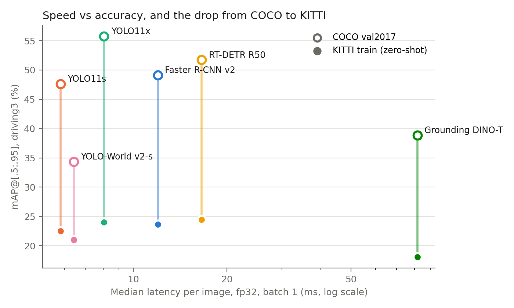
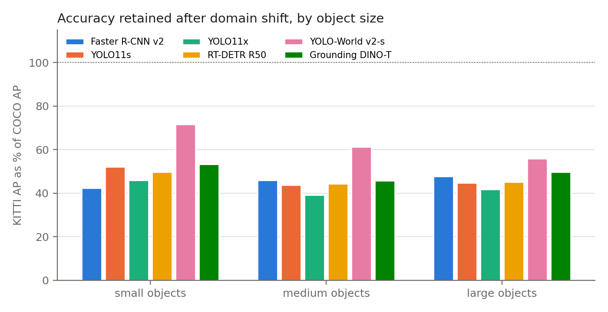
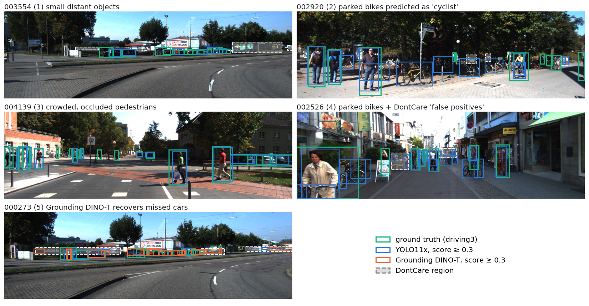

# Zero-Shot 2D Object Detection Across Domains: COCO → KITTI

**CMPE 249 Homework — 2D Object Detection, Track A (Experimental)**
Ronak Patel · November 2026
Code, configs, logs and raw metrics: <https://github.com/Ron5474/cmpe-249-assignment-1>

## 1. Objective and summary

This report evaluates six COCO-pretrained detector configurations from four detector families on two datasets, COCO val2017 (in-domain) and KITTI 2D object (driving, never seen in training), without any retraining. It asks three questions: (1) which classes and object scales degrade most under domain shift, (2) how the families trade speed against accuracy, and (3) how open-vocabulary detectors compare with closed-set ones and how sensitive they are to prompt wording.

Before any cross-dataset number was trusted, the evaluation harness was checked by reproducing published COCO mAP for the four closed-set models (Section 4.1).

Main findings:

- **Every model loses roughly half its mAP** going from COCO to KITTI (e.g. YOLO11x 55.8 → 24.0, RT-DETR 51.7 → 24.5 on the shared 3-class taxonomy).
- **Model capacity does not transfer.** YOLO11x beats YOLO11s by 8.2 mAP on COCO but only by 1.5 on KITTI. RT-DETR, not the largest YOLO, is best on KITTI.
- **Degradation is class-specific.** Vehicles keep ~80–90% of their AP, persons keep ~40%, and cyclists collapse to ~0.1 AP for every closed-set model. The cyclist collapse is a *label-definition* mismatch, not a perception failure.
- **Grounding DINO has the lowest KITTI mAP but the highest recall** (AR100 42.4 vs ~34 for closed-set models), and its accuracy depends strongly on prompt wording (18.1 vs 14.0 mAP).

## 2. Models and datasets

### 2.1 Model configurations

| Configuration | Family | Checkpoint / source | Framework |
|---|---|---|---|
| Faster R-CNN R50-FPN v2 | Two-stage, anchor-based [1, 2] | `fasterrcnn_resnet50_fpn_v2`, COCO weights [10] | torchvision 0.23.0 |
| YOLO11s, YOLO11x | One-stage, anchor-free, NMS [3, 11] | `yolo11s.pt`, `yolo11x.pt` | Ultralytics 8.3.203 |
| RT-DETR R50 | Query-based transformer, NMS-free [4, 5] | `PekingU/rtdetr_r50vd` [12] | HF Transformers 4.56.2 |
| YOLO-World v2-s | Open-vocabulary, CNN [6] | `yolov8s-worldv2.pt` | Ultralytics 8.3.203 |
| Grounding DINO-T | Open-vocabulary, transformer [7] | `IDEA-Research/grounding-dino-tiny` [12] | HF Transformers 4.56.2 |

That is six configurations from four families. YOLO11s/x are two sizes of one family and are used for the within-family speed–accuracy comparison.

### 2.2 Datasets

| Dataset | Split | Images | Notes |
|---|---|---|---|
| COCO 2017 [8] | val2017 | 5,000 (all) | Training domain of every model; in-domain baseline. |
| KITTI 2D object [9] | `training` | 7,481 (all) | Karlsruhe dashcam, 1242×375, daytime. The test split has no public labels; the training split was never used by any model here, so it is a clean zero-shot test set. |

### 2.3 Taxonomy mapping

COCO has 80 classes and KITTI has 8 plus `DontCare`. All cross-dataset numbers use the harness's `driving3` taxonomy, which folds labels and predictions *by class name* into three unified classes. **COCO is also scored in driving3**, so the COCO → KITTI drop reflects the domain change rather than a change in which classes are counted.

| Unified class | COCO names | KITTI names |
|---|---|---|
| vehicle | car, truck, bus, motorcycle, train | Car, Van, Truck, Tram |
| person | person | Pedestrian, Person_sitting |
| cyclist | bicycle | Cyclist |
| *(dropped)* | the other 72 classes | Misc, DontCare |

Two caveats are part of the analysis rather than hidden. COCO `bicycle` is the bike only, while KITTI `Cyclist` is one box around bike and rider (Section 6). KITTI `DontCare` regions are left as background, so detections inside them count as false positives.

## 3. Experimental setup

### 3.1 Harness and protocol

Evaluation uses the course's `ngdet` harness [13], pinned as a git submodule at commit `8418fc1`. A wrapper (`scripts/eval.py`) adds three things the harness lacks: a `coco80` taxonomy for the reproduction check, per-image saving of predicted and ground-truth boxes for failure analysis, and peak GPU memory and timing per run. ngdet itself is not modified.

| Setting | Value |
|---|---|
| Metric | pycocotools COCOeval, bbox, maxDets = 100 |
| Score threshold before scoring | **0.001** for all models (the tutorial default 0.3 truncates the PR curve and understates mAP) |
| Images | all images in both datasets (`--max-images 0`) |
| Input resolution | YOLO11 / YOLO-World: 640 letterbox (Ultralytics default). Faster R-CNN: shorter side 800, max 1333 (torchvision default). RT-DETR: 640×640 (HF processor). Grounding DINO: shorter side 800, max 1333 (HF processor). Boxes are mapped back to original image coordinates by each adapter. |
| NMS | YOLO: Ultralytics default IoU 0.7, max_det 300. Faster R-CNN: torchvision default IoU 0.5, 100 per image. RT-DETR (300 queries) and Grounding DINO (900 queries): no NMS. |
| Open-vocab prompts | Grounding DINO: curated synonyms `car. truck. bus. van. person. pedestrian. bicycle. cyclist .` (main run) and bare class names `vehicle. person. cyclist .` (ablation). YOLO-World: the bare class names (`set_classes`). |
| Latency | batch 1, one fixed KITTI frame (1242×375), 10 warm-up + 50 timed calls of the full `predict()` (pre-processing, forward, post-processing, label folding), `torch.cuda.synchronize()` around each call; peak memory from `torch.cuda.max_memory_allocated`. |

### 3.2 Hardware and software

| Item | Value |
|---|---|
| GPU | NVIDIA GeForce RTX 5090, 32 GB (rented on Vast.ai), driver 595.99 |
| Software | Python 3.12.15, PyTorch 2.8.0+cu128, torchvision 0.23.0, Transformers 4.56.2, Ultralytics 8.3.203, pycocotools 2.0.8; all pinned in `uv.lock` |
| OS | Linux 6.8 (container), glibc 2.39 |

Every reported number, including latency, comes from this single GPU. `results/<exp>/env.json` records the GPU, versions and exact `argv` of each run.

### 3.3 Exact commands

All experiments are run by `scripts/run_all.sh`. The command log written during the run (`results/logs/commands.log`) is:

```
uv run scripts/eval.py --exp repro_coco80 --taxonomy coco80 --max-images 0 \
  --models torchvision:fasterrcnn_resnet50_fpn_v2 yolo:yolo11s.pt yolo:yolo11x.pt \
           hf_detr:PekingU/rtdetr_r50vd --datasets coco
uv run scripts/eval.py --exp driving3 --taxonomy driving3 --max-images 0 \
  --models torchvision:fasterrcnn_resnet50_fpn_v2 yolo:yolo11s.pt yolo:yolo11x.pt \
           hf_detr:PekingU/rtdetr_r50vd yolo:yolov8s-worldv2.pt \
           gdino:IDEA-Research/grounding-dino-tiny --datasets coco kitti
uv run scripts/eval.py --exp driving3_bare --taxonomy driving3_bare --max-images 0 \
  --models gdino:IDEA-Research/grounding-dino-tiny --datasets kitti
uv run scripts/latency.py --models <the six models> --accel fp32 fp16
```

To reproduce from scratch: `git clone --recurse-submodules …`, `uv sync`, `bash scripts/download_data.sh`, `bash scripts/run_all.sh`, then `uv run scripts/analyze.py` to regenerate every table and figure in this report.

## 4. Results

### 4.1 Reproduction check (COCO val2017, all 80 classes)

| Model | Ours mAP | Published | Δ | AP50 | AP75 | AP_S | AP_M | AP_L | AR100 |
|---|---|---|---|---|---|---|---|---|---|
| Faster R-CNN v2 | 45.9 | 46.7 [10] | −0.8 | 66.3 | 50.3 | 24.2 | 44.8 | 58.7 | 60.6 |
| YOLO11s | 45.0 | 47.0 [11] | −2.0 | 61.3 | 48.6 | 21.2 | 42.8 | 60.2 | 61.4 |
| YOLO11x | 52.9 | 54.7 [11] | −1.8 | 69.2 | 57.6 | 28.4 | 52.4 | 66.9 | 68.2 |
| RT-DETR R50 | 48.2 | 53.1 [4] | **−4.9** | 64.8 | 52.5 | 25.4 | 47.3 | 62.9 | 66.1 |

Three of four models land within 2 mAP of their published values, and all are low rather than high. Two harness behaviours explain a consistent small negative bias. First, ngdet re-creates the ground truth with `iscrowd = 0` for every box, so COCO crowd regions become ordinary objects that can only be missed. Second, ngdet computes area from the box rather than COCO's mask area, which moves some objects between the small/medium/large bins. The YOLO gap is also consistent with `predict()` using plain letterbox inference rather than the rectangular-batch validation Ultralytics uses for its published numbers.

**The RT-DETR gap of −4.9 is too large for those causes and remains unexplained.** The HF processor's 640×640 resize and RT-DETR's top-300 post-processing match the official setup as far as I verified, so I treat the RT-DETR COCO number as a lower bound and do not use it to rank RT-DETR against the YOLOs on COCO. The harness is trusted for *relative* COCO → KITTI comparisons, which are made under identical conditions.

### 4.2 Cross-dataset results (driving3 taxonomy)

| Model | Data | mAP | AP50 | AP75 | AP_S | AP_M | AP_L | AR100 |
|---|---|---|---|---|---|---|---|---|
| Faster R-CNN v2 | COCO | 49.1 | 75.2 | 52.3 | 28.6 | 49.8 | 66.0 | 60.6 |
| | KITTI | 23.7 | 43.9 | 23.4 | 12.1 | 22.9 | 31.5 | 34.2 |
| YOLO11s | COCO | 47.6 | 69.3 | 51.0 | 20.1 | 48.8 | 70.4 | 62.0 |
| | KITTI | 22.5 | 42.9 | 21.5 | 10.5 | 21.3 | 31.5 | 34.1 |
| YOLO11x | COCO | **55.8** | **77.3** | **60.6** | **29.5** | **58.3** | **75.5** | **68.1** |
| | KITTI | 24.0 | 44.6 | 23.5 | **13.5** | 22.8 | 31.4 | 34.1 |
| RT-DETR R50 | COCO | 51.7 | 75.4 | 54.2 | 26.6 | 52.7 | 72.6 | 67.1 |
| | KITTI | **24.5** | **45.0** | **23.8** | 13.2 | **23.4** | **32.7** | 36.2 |
| YOLO-World v2-s | COCO | 34.4 | 50.4 | 36.3 | 13.8 | 33.5 | 55.8 | 52.7 |
| | KITTI | 21.0 | 39.9 | 20.2 | 9.9 | 20.5 | 31.1 | 34.6 |
| Grounding DINO-T | COCO | 38.9 | 54.5 | 42.8 | 20.4 | 41.3 | 55.3 | 60.7 |
| | KITTI | 18.1 | 35.1 | 17.0 | 10.9 | 18.9 | 27.5 | **42.4** |

**Per-class AP@[.5:.95], COCO → KITTI**

| Model | vehicle | person | cyclist |
|---|---|---|---|
| Faster R-CNN v2 | 53.1 → 45.3 | 56.5 → 25.5 | 37.8 → 0.1 |
| YOLO11s | 51.6 → 44.5 | 56.2 → 22.9 | 35.0 → 0.1 |
| YOLO11x | 59.5 → 47.6 | 62.7 → 24.3 | 45.1 → 0.1 |
| RT-DETR R50 | 56.3 → 49.2 | 59.3 → 24.1 | 39.5 → 0.1 |
| YOLO-World v2-s | 37.5 → 40.6 | 51.7 → 21.6 | 13.9 → 0.8 |
| Grounding DINO-T | 36.7 → 33.7 | 52.4 → 18.6 | 27.5 → 1.9 |

### 4.3 Latency and memory (RTX 5090, batch 1, KITTI frame)

| Model | fp32 ms | fp32 FPS | fp32 peak MB | fp16 ms | fp16 FPS | fp16 peak MB |
|---|---|---|---|---|---|---|
| Faster R-CNN v2 | 11.98 | 83.5 | 473 | 9.32 | 107.3 | 245 |
| YOLO11s | 5.84 | 171.3 | 87 | 5.96 | 167.9 | 84 |
| YOLO11x | 8.05 | 124.3 | 421 | 8.43 | 118.7 | 284 |
| RT-DETR R50 | 16.57 | 60.3 | 298 | 16.90 | 59.2 | 343 |
| YOLO-World v2-s | 6.44 | 155.4 | 935 | 6.70 | 149.3 | 938 |
| Grounding DINO-T | 81.76 | 12.2 | 1,621 | n/a* | | |

\*The ngdet Grounding DINO adapter accepts an `accel` argument but never applies it, so its "fp16" run was actually fp32 (79.6 ms, 1,622 MB) and is not reported as fp16.

## 5. Technical analyses

### 5.1 Cross-dataset generalization: which classes and scales degrade most?



**Overall.** All six models lose 39–57% of their mAP on KITTI. The closed-set models converge to a narrow 22.5–24.5 band even though they span 47.6–55.8 on COCO: domain shift removes most of the advantage of a better COCO model. The clearest case is within one family. YOLO11x's 8.2-point lead over YOLO11s on COCO shrinks to 1.5 points on KITTI, so the extra capacity mostly fits COCO-specific appearance rather than transferable features.

**By class.** Vehicles transfer best (they keep 80–89% of COCO AP for the closed-set models). KITTI is dominated by cars seen from a dashcam, which is also a common COCO viewpoint for cars. **Persons lose more than half their AP** (e.g. 56.5 → 25.5 for Faster R-CNN). KITTI pedestrians are small, often in groups, partially occluded by parked cars, and seen side-on at a distance, which COCO's photographer-framed people rarely are (Figure 3, frame 004139). **Cyclist AP falls to 0.1 for every closed-set model**, discussed in Section 6 as a definition problem.

**By scale.** The scale-retention chart shows a slightly different pattern from what I expected. KITTI AP drops to roughly 40–50% of COCO AP *in every size bin*, not just for small objects. In absolute terms small objects are worst (AP_S ≈ 10–13 on KITTI), but they were already weak on COCO, so their relative loss is similar. The domain gap is therefore not just a resolution problem. The 1242-pixel-wide KITTI frames are downscaled more than COCO images by every model's resize (to 640 wide for YOLO and RT-DETR), which shrinks KITTI's already-distant objects; that hurts absolute small-object AP but does not explain the uniform loss on large objects, which points to appearance and context differences (viewpoint, occlusion, lighting) as well.



YOLO-World retains the largest fraction in every bin, but only because its COCO baseline is low. In absolute KITTI AP it is still below every closed-set model.

### 5.2 Architecture comparison and speed–accuracy trade-off

**Two-stage vs one-stage vs query-based.** On COCO the ranking follows model capacity (YOLO11x > RT-DETR > Faster R-CNN > YOLO11s). On KITTI, **RT-DETR is best overall (24.5 mAP) and has the best AR100 among closed-set models (36.2)**, and Faster R-CNN, an older two-stage design, ties YOLO11x (23.7 vs 24.0). One plausible reason is post-processing. RT-DETR's set prediction needs no NMS, while YOLO and Faster R-CNN suppress overlapping boxes. KITTI scenes have many overlapping parked cars and grouped pedestrians, where NMS can remove true positives. I did not isolate this effect experimentally, so it is a hypothesis.

**Speed.** On the RTX 5090 at batch 1, the YOLO family is fastest (5.8–8.1 ms), Faster R-CNN and RT-DETR are mid-range (12–17 ms), and Grounding DINO is an order of magnitude slower (82 ms, 12 FPS). For KITTI, the speed–accuracy frontier is very flat: YOLO11s at 5.8 ms is only 2 mAP behind the best model at 16.6 ms. **For a driving deployment under this kind of domain shift, the small model is nearly as accurate as the large ones at a third of the latency.**

**fp16 helps only Faster R-CNN** (12.0 → 9.3 ms, memory halved). For the YOLOs and RT-DETR, fp16 cuts memory where it applies but not time, and is sometimes marginally slower. The latency here covers the whole `predict()` call, including CPU-side image conversion and resizing, so for models whose GPU forward pass is only a few milliseconds the timing is dominated by work that fp16 does not speed up. This is my interpretation of the measurements; I did not profile the individual stages.

**Memory** is small for all closed-set models (≤ 0.5 GB). The open-vocabulary models are the heaviest: YOLO-World's text encoder brings it to 0.9 GB despite its small detector, and Grounding DINO uses 1.6 GB.

### 5.3 Closed-set vs open-vocabulary detection

**Open-vocabulary models are not more robust to this domain shift in mAP terms.** Grounding DINO-T (18.1) and YOLO-World v2-s (21.0) are both below every closed-set model on KITTI. However, **Grounding DINO has by far the highest recall (AR100 42.4 vs 34–36)**. It finds more of the objects but ranks and localizes them worse. Its AP75 (17.0) is the lowest of all models while its AR is the highest, which means the problem is box precision and score calibration, not missed objects (Figure 3, frame 000273, where it recovers several distant cars YOLO11x misses).

**Open-vocabulary detectors do better on the label-mismatch class.** On cyclist, Grounding DINO reaches 1.9 AP and YOLO-World 0.8, against 0.1 for every closed-set model. A text prompt such as `cyclist` can match the bike-plus-rider concept, while a closed-set head can only emit COCO's `bicycle`. The absolute values are still very low.

**Prompt wording matters a great deal.**

| Grounding DINO-T prompt (KITTI) | mAP | AR100 | vehicle | person | cyclist |
|---|---|---|---|---|---|
| curated: `car. truck. bus. van. person. pedestrian. bicycle. cyclist .` | **18.1** | **42.4** | **33.7** | 18.6 | 1.9 |
| bare: `vehicle. person. cyclist .` | 14.0 | 39.9 | 12.5 | **25.5** | **3.9** |

Prompting with concrete nouns (`car. truck. bus. van`) instead of the abstract word `vehicle` nearly triples vehicle AP (12.5 → 33.7). The effect reverses for the other classes: bare `person` beats `person. pedestrian` (25.5 vs 18.6), and bare `cyclist` beats `bicycle. cyclist` (3.9 vs 1.9). A likely explanation is that adding `pedestrian` and `bicycle` splits the score mass across two phrases and, for `bicycle`, attracts boxes around parked bikes that KITTI does not label. **There is no single best prompt; the right wording is class-dependent**, so open-vocabulary results should always be reported with their exact prompt.

## 6. Failure analysis



*Figure 3. Green: ground truth in driving3. Blue: YOLO11x detections with score ≥ 0.3. Orange: Grounding DINO-T (frame 000273 only). White dashed: KITTI DontCare regions. Frames were selected automatically from the saved per-image boxes as the worst cases for each failure type; numbers match the list below.*

1. **Small, distant objects (003554).** A row of cars at the far end of the road is under 25 pixels tall after resizing. Most are found, but several are missed or poorly localized, which matches the low AP_S.
2. **Cyclist definition mismatch (002920).** YOLO11x labels many **parked bicycles** as `cyclist`, because COCO `bicycle` is any bike. KITTI labels only ridden bikes, and boxes rider and bike together. Each parked bike becomes a false positive, and the real cyclist's rider is predicted as a separate `person`. This is why cyclist AP is ~0.1 for every closed-set model; it is a taxonomy problem, and fixing it would need a rule that merges `person` and `bicycle` boxes, or fine-tuning.
3. **Crowded, occluded pedestrians (004139).** A group of pedestrians on the left is partially occluded and close together. Several are missed, consistent with NMS suppressing adjacent boxes and with the large person-AP drop.
4. **Penalties from the evaluation itself (002526).** Many "false positives" are parked bicycles (the cyclist mismatch again) or detections inside DontCare regions. Because ngdet treats DontCare as background (ADR-0001), a detector that correctly sees a distant, unlabeled object is penalized. This lowers KITTI precision for all models, and somewhat more for models that detect more distant objects.
5. **Open-vocabulary recall (000273).** Grounding DINO recovers several distant cars that YOLO11x misses, but its boxes around the far car row are looser and several fall in DontCare regions, illustrating its high-AR, low-AP75 profile.

**Limitations of this study.**

- KITTI numbers are COCO-style AP over size bins, not the official KITTI Easy/Moderate/Hard metric (IoU 0.7 for cars), so they are not comparable with the KITTI leaderboard.
- The harness converts COCO crowd regions into normal ground truth and uses box area. This biases all COCO numbers down slightly but equally.
- RT-DETR's COCO reproduction gap (−4.9) is unexplained.
- Latency is the full adapter pipeline at batch 1, not pure network time; Grounding DINO fp16 was not actually applied by the adapter.
- A third, condition-diverse driving dataset (nuImages: night, rain, Singapore) was planned but dropped for time, so all driving results come from one city in daytime.
- No fine-tuning was done, so the analysis cannot say how much of the gap a few hundred KITTI labels would recover.

## 7. Conclusions

1. **COCO accuracy is a poor predictor of driving-domain accuracy.** All six models lose roughly half their mAP on KITTI, and the closed-set models compress into a 2-point band. The best KITTI model (RT-DETR) is not the best COCO model (YOLO11x).
2. **The losses are class-specific and partly caused by label definitions.** Vehicles transfer well, persons lose more than half their AP, and cyclists collapse because COCO and KITTI define the class differently. Some of the measured "domain gap" is a definition gap.
3. **For speed–accuracy under domain shift, small models win.** YOLO11s is within 2 mAP of the best KITTI model at a third of its latency. fp16 helped only Faster R-CNN at batch 1.
4. **Open-vocabulary detection trades precision for recall.** Grounding DINO finds the most objects but scores and localizes them worse, runs 10× slower, and its per-class accuracy changes by nearly 3× depending on prompt wording.
5. **Validating the harness was worth it.** The reproduction check showed a small, explainable negative bias for three models and an unexplained gap for RT-DETR, which is why this report compares models by their *relative* COCO → KITTI change.

## References

**Papers**

- [1] S. Ren, K. He, R. Girshick, J. Sun. "Faster R-CNN: Towards Real-Time Object Detection with Region Proposal Networks." NeurIPS 2015.
- [2] T.-Y. Lin, P. Dollár, R. Girshick, K. He, B. Hariharan, S. Belongie. "Feature Pyramid Networks for Object Detection." CVPR 2017.
- [3] J. Redmon, S. Divvala, R. Girshick, A. Farhadi. "You Only Look Once: Unified, Real-Time Object Detection." CVPR 2016.
- [4] Y. Zhao, W. Lv, S. Xu, J. Wei, G. Wang, Q. Dang, Y. Liu, J. Chen. "DETRs Beat YOLOs on Real-time Object Detection." CVPR 2024.
- [5] N. Carion, F. Massa, G. Synnaeve, N. Usunier, A. Kirillov, S. Zagoruyko. "End-to-End Object Detection with Transformers." ECCV 2020.
- [6] T. Cheng, L. Song, Y. Ge, W. Liu, X. Wang, Y. Shan. "YOLO-World: Real-Time Open-Vocabulary Object Detection." CVPR 2024.
- [7] S. Liu et al. "Grounding DINO: Marrying DINO with Grounded Pre-Training for Open-Set Object Detection." ECCV 2024.
- [8] T.-Y. Lin et al. "Microsoft COCO: Common Objects in Context." ECCV 2014.
- [9] A. Geiger, P. Lenz, R. Urtasun. "Are we ready for Autonomous Driving? The KITTI Vision Benchmark Suite." CVPR 2012.

**Official repositories and documentation**

- [10] PyTorch torchvision, "Models and pre-trained weights: `fasterrcnn_resnet50_fpn_v2`" (COCO box mAP 46.7). <https://pytorch.org/vision/stable/models.html>
- [11] Ultralytics, "YOLO11" documentation (COCO val mAP 47.0 for YOLO11s, 54.7 for YOLO11x). <https://docs.ultralytics.com/models/yolo11/>
- [12] Hugging Face Transformers documentation, RT-DETR and Grounding DINO model pages. <https://huggingface.co/docs/transformers>
- [13] K. Liu, DeepDataMiningLearning, `ngdet` tutorial and harness (commit `8418fc1`). <https://github.com/lkk688/DeepDataMiningLearning/blob/main/DeepDataMiningLearning/ngdet/TUTORIAL.md>
